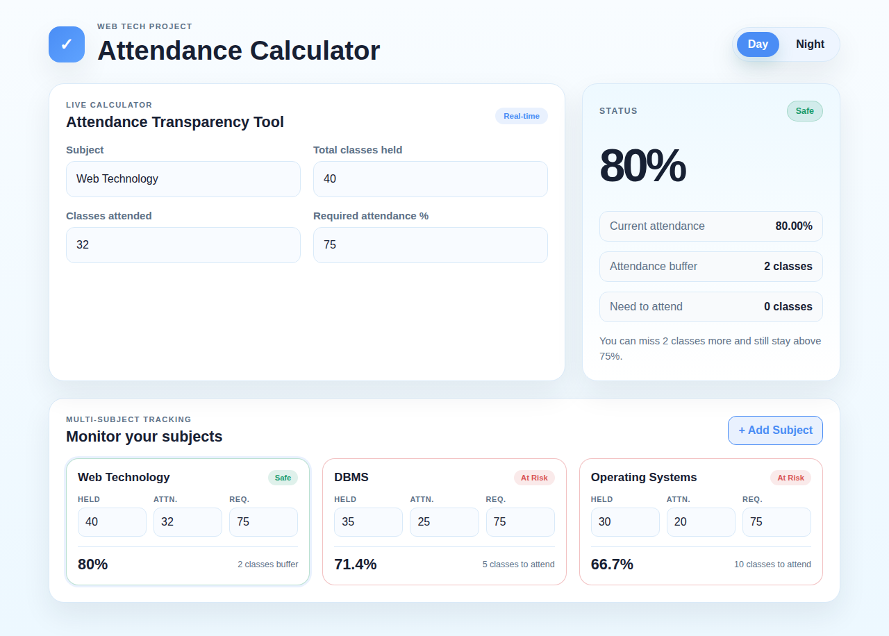
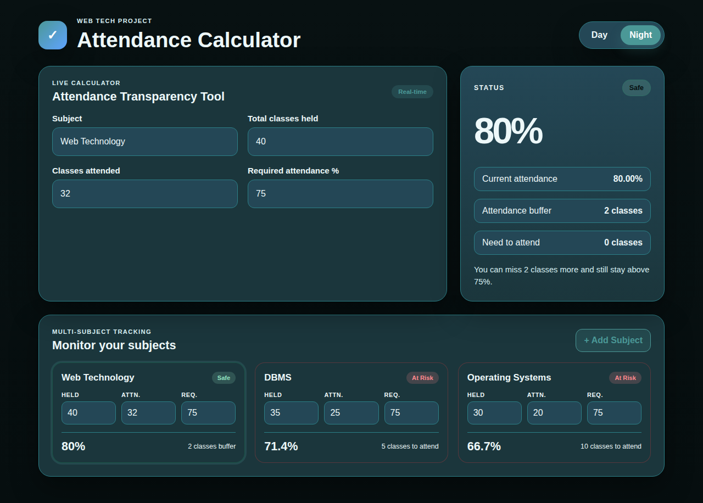
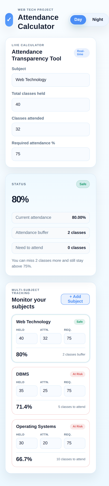

<div align="center">

# ✓ Attendance Calculator

**Know exactly where you stand, before you decide to skip that class.**

A real-time attendance tool that tells students how many classes they can still miss, or how many they need to attend to get back on track. Built with plain HTML, CSS and JavaScript.


<br />



</div>

---

## 📖 About

Most students only find out they are short on attendance when it is too late, and the manual maths is easy to get wrong. This project works like a **bank balance checker for attendance**: it shows your current status and the consequences of your next decision, instantly.

> The goal is awareness, not encouraging absenteeism.

## ✨ Features

| | Feature | What it does |
|---|---|---|
| 📊 | **Live calculation** | Results update on every keystroke, with no button and no page reload |
| 🟢 | **Three-level status** | Classifies each subject as **Safe**, **Borderline** or **At Risk** |
| 🛟 | **Attendance buffer** | Shows exactly how many more classes you can miss |
| 🚑 | **Recovery count** | Shows how many classes in a row you must attend to get back above the requirement |
| 📚 | **Multi-subject tracking** | Add as many subjects as you like, each with its own requirement |
| 🛡️ | **Input validation** | Clear error messages for empty, negative, fractional or impossible values |
| 🌗 | **Day / Night mode** | Theme switch that is remembered between visits |
| 📱 | **Responsive** | Works on phones, tablets and desktops |

## 🖼️ Screenshots

<table>
  <tr>
    <td align="center"><b>Night mode</b></td>
    <td align="center"><b>Mobile</b></td>
  </tr>
  <tr>
    <td></td>
    <td></td>
  </tr>
</table>

## 🚀 Getting Started

No installation, build step or server is needed.

```bash
# 1. Clone the repository
git clone https://github.com/<your-username>/<your-repo>.git
cd <your-repo>

# 2. Open it in your browser
#    Just double-click index.html, or:
open index.html          # macOS
start index.html         # Windows
xdg-open index.html      # Linux
```

Prefer a local server (for live reload)? Either of these works:

```bash
python -m http.server 8000      # then visit http://localhost:8000
```

or use the **Live Server** extension in VS Code.

## 🧮 How It Works

Let **r** be the required attendance as a decimal (75% becomes 0.75).

| Output | Formula |
|---|---|
| Attendance % | `attended ÷ total × 100` |
| Buffer (classes you can still miss) | `⌊ attended ÷ r − total ⌋` |
| Recovery (classes to attend in a row) | `⌈ (r × total − attended) ÷ (1 − r) ⌉` |

**Status rules**

| Status | When |
|---|---|
| 🟢 Safe | Above the requirement with more than 1 class of buffer |
| 🟡 Borderline | At or above the requirement, but with 1 spare class or none |
| 🔴 At Risk | Below the requirement |

**Example** with the default data and a 75% requirement:

| Subject | Held | Attended | Result |
|---|---|---|---|
| Web Technology | 40 | 32 | 80%, **Safe**, can miss 2 more |
| DBMS | 35 | 25 | 71.4%, **At Risk**, attend 5 in a row |
| Operating Systems | 30 | 20 | 66.7%, **At Risk**, attend 10 in a row |

> The calculations use whole numbers internally (the required % is scaled by 10), so decimal requirements like 67.5% never cause floating point rounding errors.

## 📁 Project Structure

```
attendance-calculator/
├── index.html      # Page structure and input elements
├── style.css       # Layout, day/night themes, responsiveness
├── script.js       # Calculations, validation, and live UI updates
└── docs/           # Screenshots used in this README
```

**How the JavaScript is organised** (`script.js`)

1. **Validation:** `validateRaw()` turns what the user typed into safe numbers and error messages.
2. **Calculation:** `calculateAttendance()` returns the percentage, status, buffer, recovery count and a plain-English message.
3. **Rendering:** subject cards are built once and then updated in place, so typing never loses focus.
4. **Events:** an `input` event runs validation, recalculation and a redraw. A `change` event tidies the field when you leave it.

## 🔧 Customising

| Want to change... | Edit this in `script.js` |
|---|---|
| How close to the limit counts as Borderline | `BORDERLINE_BUFFER` |
| Starting subjects | `defaultSubjects` |
| Maximum classes allowed | `MAX_CLASSES` |
| Colours and themes | CSS variables at the top of `style.css` |

## 🗺️ Roadmap

- [x] Live attendance calculator
- [x] Buffer and recovery calculations
- [x] Safe / Borderline / At Risk status
- [x] Multi-subject tracking
- [x] Day / Night mode
- [x] Input validation with error messages
- [ ] Progress bar for each subject
- [ ] "What-if" input to test a decision before making it
- [ ] Overall summary card
- [ ] Save all subjects with `localStorage`
- [ ] Delete and rename subjects
- [ ] Low-attendance notifications and attendance history

## 🆚 How It Differs From Similar Tools

- No AI, no screenshot upload and no sign-up, so it just works
- Tracks **multiple subjects** at once, not a single number
- Shows **both sides** of the problem: what you can miss and what you must attend
- Visual risk levels instead of just a percentage
- Works for any college and any attendance requirement

## 👩‍💻 Author

Made by **Mansha Mehra** as a Web Technology course project.

---

<div align="center">

If this helped you, consider giving the repo a ⭐

</div>